# Razvojno okruženje i životni ciklus aplikacije

IDE (Integrated Development Environment) predstavlja integrirano razvojno okruženje
koje programerima omogućuje kreiranje, uređivanje i testiranje programskih sustava.
Takvo okruženje objedinjuje više alata koji su potrebni za razvoj softvera, poput uređivača
koda, prevoditelja, simulatora i alata za otklanjanje pogrešaka. Xcode je službeni Appleov IDE
koji se koristi za razvoj programskih proizvoda u programskom jeziku Swift, namijenjenih za Apple platforme.

## 1. Instalacija i prvo pokretanje Xcodea

Prvi korak instalacije bio je otvaranje **App Storea** na **Mac** uređaju gdje u tražilicu unesemo pojam koji želimo pretražiti, to jest u ovom slučaju **Xcode**. Klikom na gumb **Get** započinje proces preuzimanja i
instalacije.

<a href="Documentation/01-instalacija-xcodea.png">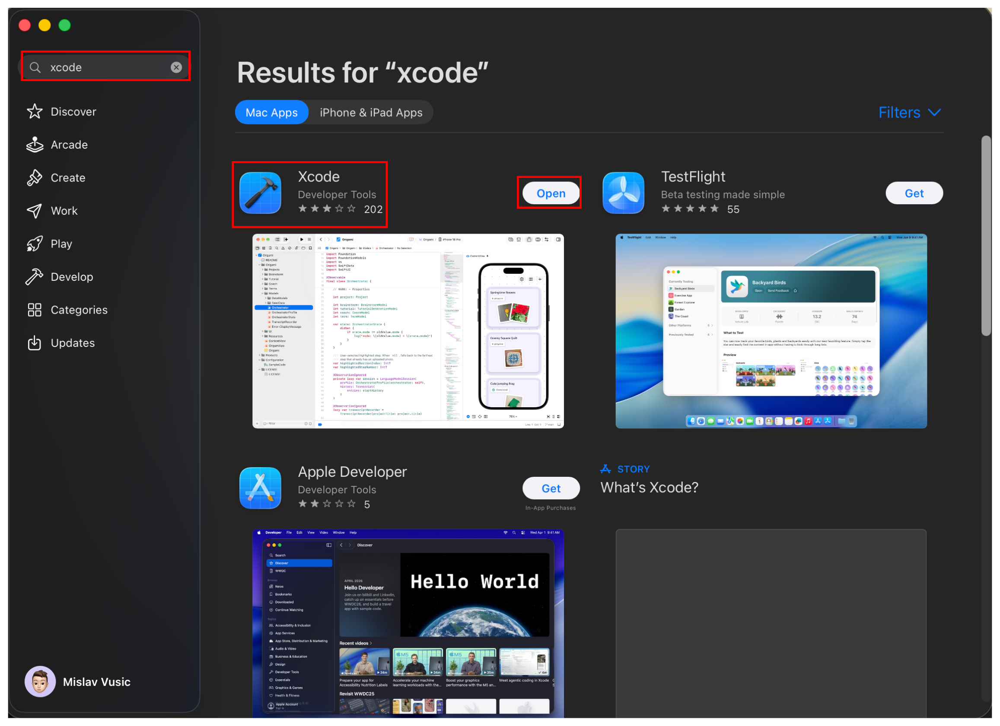</a>

Nakon što se aplikacija **Xcode** uspješno preuzme i instalira, pri prvom pokretanju
pojavljuje se prozor s  ugovorom pod nazivom “Xcode and Apple SDKs
Agreement", ovaj korak je obavezan prije korištenja alata. Kako bih korisnik mogao koristiti alat, on mora prihvatiti uvjete
koje korištenja koje propisuje Apple.

<a href="Documentation/02-prihvacanje-licencnih-uvjeta.png">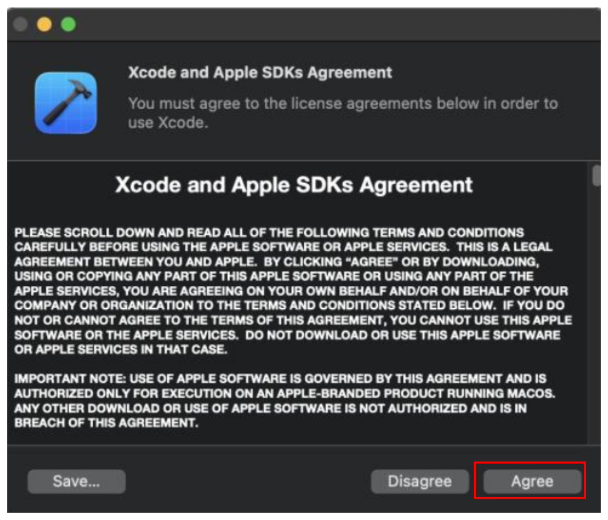</a>

Nakon prihvaćanja Applevog ugovora prikazuje se popis  dostupnih Xcode komponenti koje se mogu instalirati. 
Ovdje korisnik može odabrati komponente ovisno o tome za koje će platforme željeti razvijati aplikacije npr. iOS, watchOS, tvOS ili visionOS.
Ukoliko korisnik želi razijvati aplikacije samo za macOS tada netreba ništa dodatno instalirati jer je podrška već ugrađena. Također korisnik može odabrati i "Predictive Code Completion Model" komponentu koja koristi model umjetne inteligencije
za code completion.

<a href="Documentation/03-instalacija-razvojnih-komponenti.png">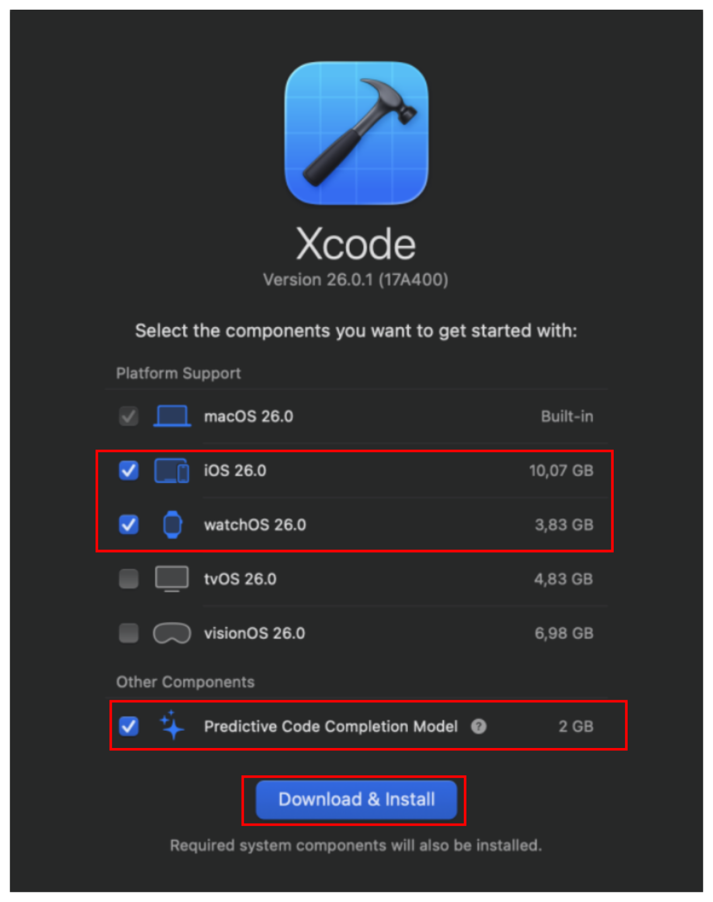</a>

## 2. Izrada i početne postavke projekta

Pokretanjem Xcodea otvara se novi početni prozor koji je polazišna točka. U središnjem dijelu prikazani su naziv alata i njegova verzija, a ispod njih nalaze se tri opcije za početak rada. Opcija Create New Project služi za izradu nove aplikacije, dok Clone Git Repository omogućuje preuzimanje postojećeg projekta iz udaljenog Git repozitorija, primjerice s GitHuba. Za otvaranje projekta pohranjenog na računalu koristi se opcija Open Existing Project.
Na desnoj strani prozora nalazi se popis nedavno otvorenih projekata

<a href="Documentation/04-kreiranje-projekta.png">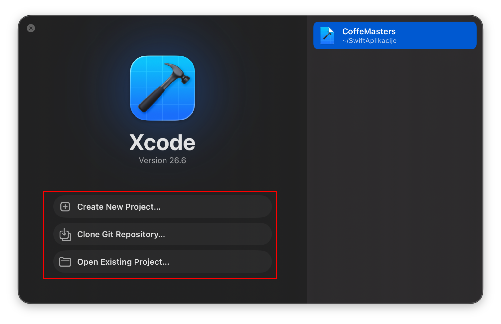</a>

Xcode nudi više različitih predložaka ovisno o vrsti  aplikacije koja se želi izraditi, primjerice za iOS, macOS, watchOS ili tvOS. U ovom prozoru
prikazane su osnovne opcije kao što su App, Game, Augmented Reality App i druge. Za izradu obične mobilne aplikacije najčešće se bira prva opcija App u tabu iOS, koja služi
kao osnovni predložak za početak razvoja. Nakon odabira klikne se na gumb Next kako bi se koristio odabrani predložak

<a href="Documentation/04a-odabir-predloska-projekta.png">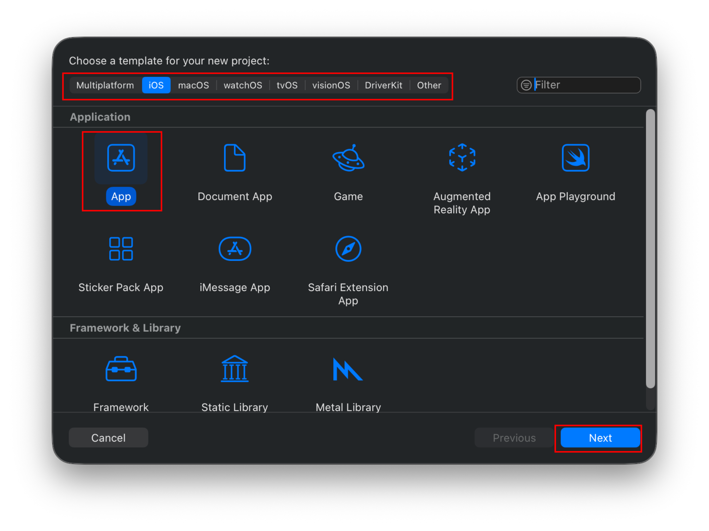</a>

U ovom dijelu  biraju se opcije za projekt. Polje Product Name označava naziv aplikacije,
polje Team koristi se ako je korisnik prijavljen u Apple Developer račun, ali to se može i naknadno dodati. Organization Identifier predstavlja jedinstveni identifikator koji se
obično sastoji od naziva organizacije u obrnutom redoslijedu (npr. RAMPU.com), a zajedno s nazivom aplikacije tvori Bundle
Identifier, koji je jedinstven i koji se koristi za prepoznavanje svake aplikacije. Interface polje označava tehnologiju za razvoj UI(User Interface), moguće je odabrati Storyboard koji se veže sa UIKitom ili SwiftUI, koji omogućuje bržu i moderniju izradu dizajna aplikacije pomoću Swift jezika. 
U polju Language ostavljen je zadani izbor Swift, a ako se odabere opcija Storyboard, onda imamo mogućnost koristiti Objective-C.
Opcija Testing System služi za odabir načina testiranja aplikacije, a Storage označava sustav
za pohranu podataka. Nakon što su svi podaci ispunjeni, kliknemo na gumb Next.

<a href="Documentation/05-osnovne-postavke-projekta.png">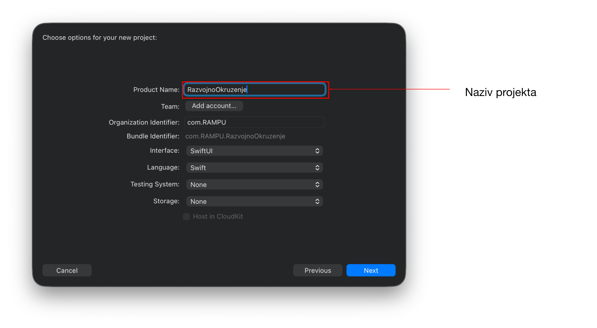</a>

<a href="Documentation/06-dodavanje-apple-racuna.png">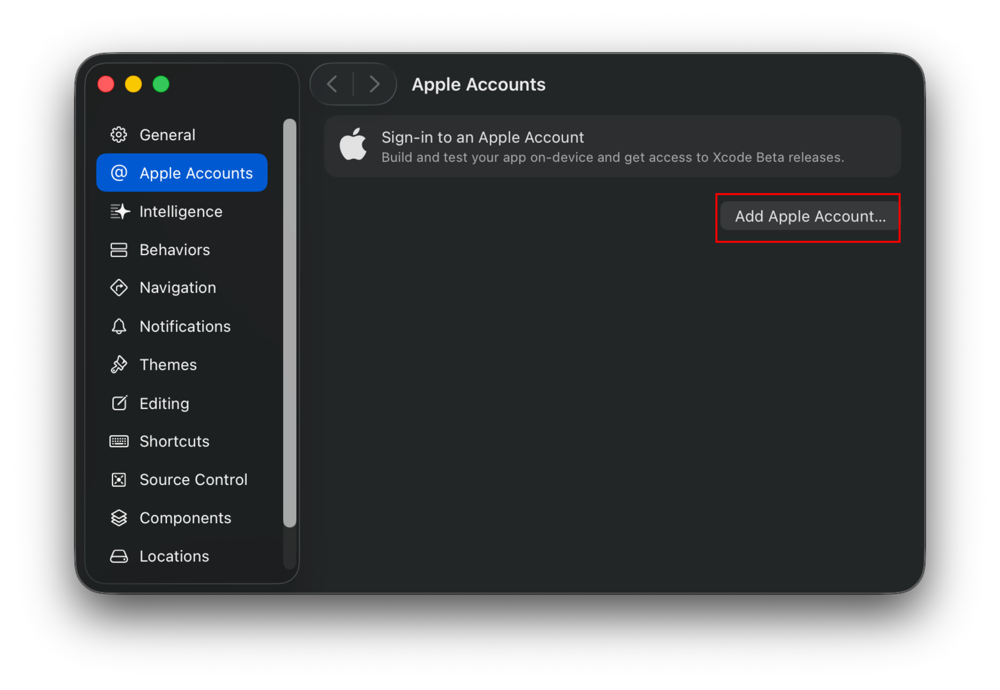</a>

<a href="Documentation/07-odabir-korisnickog-sucelja.png">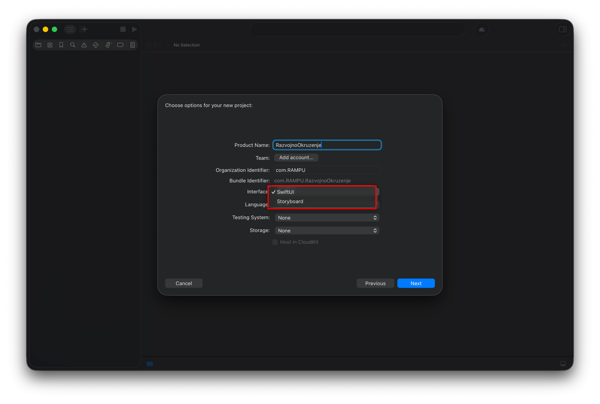</a>

<a href="Documentation/08-odabir-programskog-jezika.png">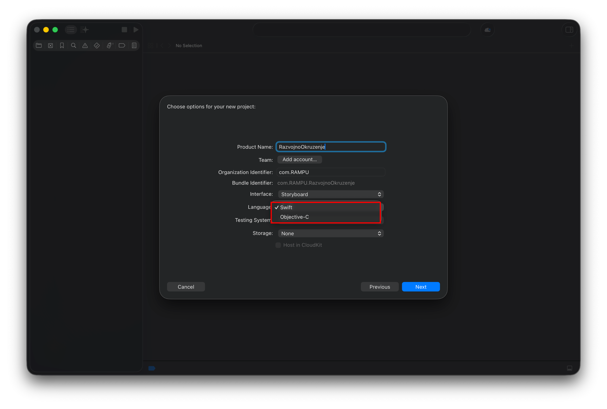</a>

<a href="Documentation/09-odabir-sustava-za-testiranje.png">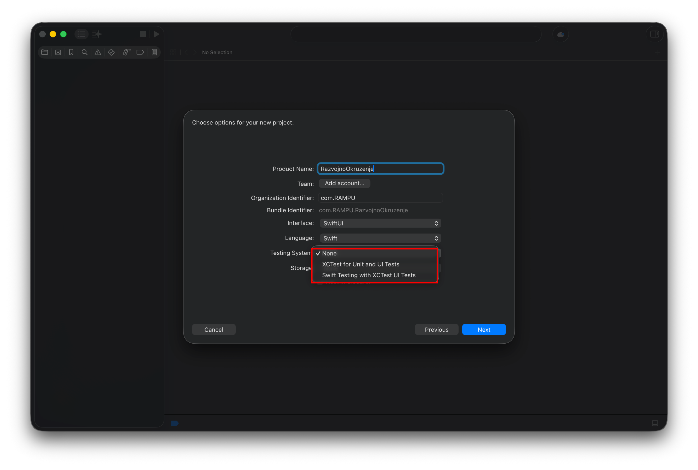</a>

<a href="Documentation/10-odabir-pohrane-podataka.png">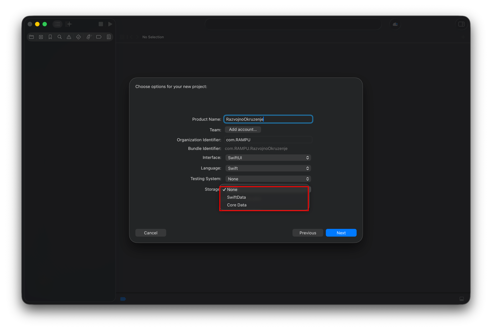</a>

U zadnjem koraku  stvaranja projekta potrebno je odabrati lokaciju na računalu
gdje će se projekt spremiti.Na primjer u slučaju dolje na slici u mapu SwiftAplikacije. Na dnu prozora nalazi se opcija **Create Git repository on my Mac**, koja služi kako
bi projekt postao Git repozotrij kojeg mozemo verzionirati putem Gita . Nakon što je odabrana lokacija, klikom
na gumb Create Xcode kreira sve potrebne datoteke i otvara novi projekt spreman za rad.

<a href="Documentation/11-spremanje-projekta-i-git-repozitorij.png">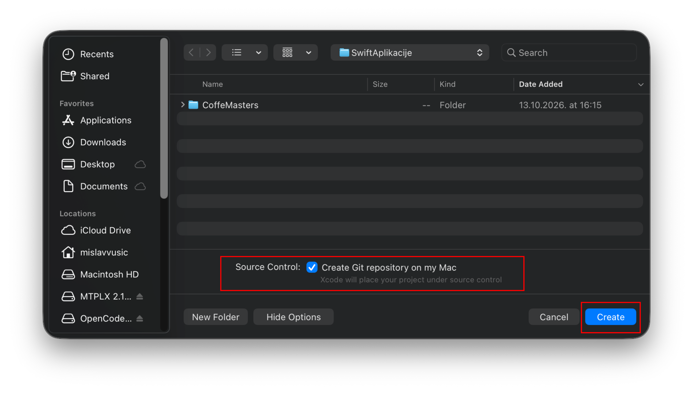</a>

Nakon što Xcode završi stvaranje projekta, otvara se glavni prozor razvojnog okruženja s početnim datotekama aplikacije. Odabirom datoteke `ContentView.swift` prikazuje se SwiftUI kod kojim je definiran početni izgled korisničkog sučelja. U ovom primjeru u kodu se nalaze ikona i tekst „Hello, world!”, a njihov izgled može se vidjeti u prikazu s desne strane prozora, koji se naziva preview. Taj prikaz omogućuje pregled sučelja tijekom pisanja koda, bez pokretanja cijele aplikacije u zasebnom simulatoru. Pri prvom otvaranju projekta potrebno je pričekati da Xcode dovrši početne zadatke i pripremi preview.

<a href="Documentation/12-prvi-prikaz-projekta-u-xcodeu.png">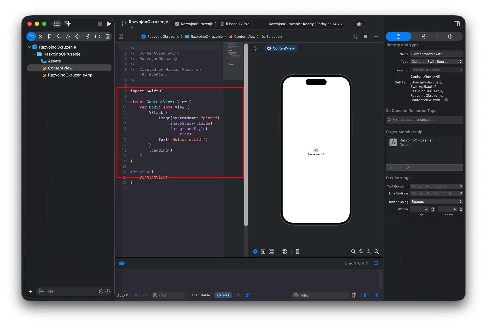</a>

## 3. Pregled Xcode sučelja

Glavni prozor Xcodea podijeljen je na nekoliko područja koja programeru omogućuju organizaciju datoteka, pisanje koda i praćenje rada aplikacije. Na lijevoj strani nalazi se **Navigator**, koji služi za pristup datotekama, pretraživanje projekta i pregled različitih izvještaja. Središnji dio prozora zauzima **Editor**, odnosno uređivač u kojem se prikazuje sadržaj odabrane datoteke. Na desnoj strani nalazi se **Inspector**, koji prikazuje svojstva i dodatne informacije o odabranom elementu ili datoteci.

U gornjem dijelu prozora smješten je **Toolbar**, odnosno alatna traka s kontrolama za izgradnju i pokretanje aplikacije, dok se pri dnu nalazi **Debug area**, područje za pregled varijabli i poruka tijekom izvođenja programa. Na sljedećoj slici ta su područja obojena i povezana s odgovarajućim oznakama kako bi se lakše uočio njihov položaj. Sličan pregled dijelova sučelja prikazan je u [uvodnom članku Hine Khan](https://medium.com/@hinaabbaskhan/introduction-to-swift-programming-part-2-getting-started-with-xcode-3d39fc43f4e6).

<a href="Documentation/13-dijelovi-xcode-sucelja.png">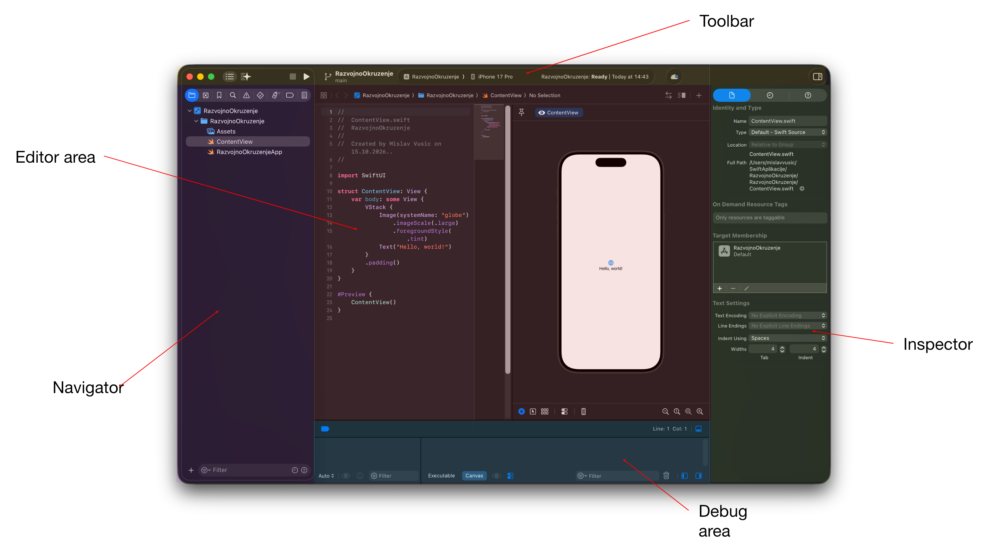</a>

Alatna traka nalazi se pri vrhu Xcode prozora i sadrži kontrole koje se koriste tijekom razvoja aplikacije. U njoj se nalaze gumbi za pokretanje i zaustavljanje aplikacije, izbornici za odabir sheme i uređaja te informacije o trenutačnim zadacima koje Xcode izvršava. Klikom na označeni izbornik uz naziv projekta otvara se pregled trenutačne Git grane. U prikazanom primjeru odabrana je grana `main`, koja predstavlja glavnu granu repozitorija. Ovaj prikaz omogućuje programeru da provjeri na kojoj grani radi prije nego što nastavi s izmjenama projekta.

<a href="Documentation/14-alatna-traka-i-git-grana.png">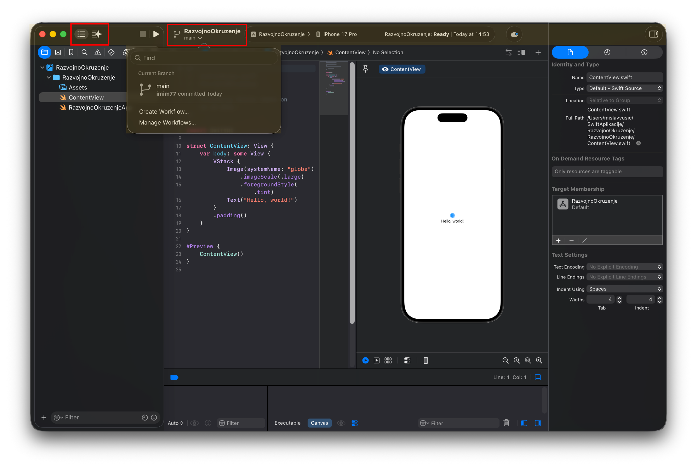</a>

U alatnoj traci, lijevo od naziva odabranog uređaja, nalazi se izbornik za odabir **sheme** projekta. Shema određuje koje ciljeve, odnosno targete, i postavke Xcode koristi pri izgradnji, pokretanju, testiranju ili analizi aplikacije. Klikom na naziv aplikacije otvara se popis dostupnih shema. U ovom primjeru koristi se početna shema koju je Xcode stvorio zajedno s projektom i koja je namijenjena izgradnji i pokretanju aplikacije.

<a href="Documentation/15-odabir-projekta.png">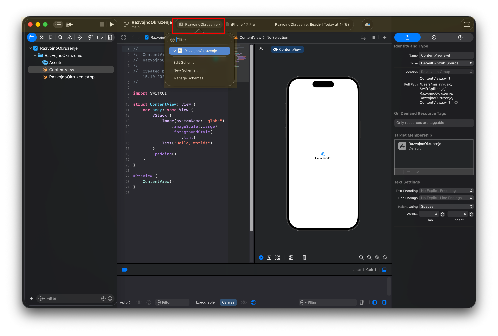</a>

Desno od izbornika sheme nalazi se izbornik za odabir uređaja na kojem će se aplikacija pokrenuti. Klikom na naziv trenutačno odabranog uređaja otvara se popis dostupnih simulatora i povezanih fizičkih uređaja. Simulator omogućuje pokretanje aplikacije u virtualnom okruženju koje oponaša odabrani model iPhonea ili iPada. Za početno pokretanje odabire se jedan od instaliranih iPhone simulatora, dok se povezani fizički iPhone može odabrati nakon što je pripremljen za razvoj. Dostupni modeli ovise o simulatorima i razvojnim komponentama koje su instalirane na računalu.

<a href="Documentation/16-odabir-uredaja-i-simulatora.png">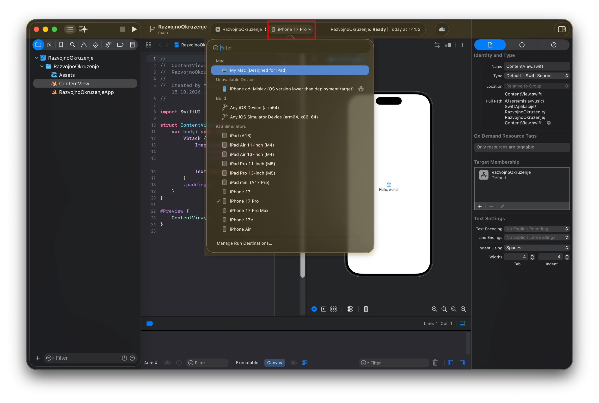</a>

Na desnoj strani Xcode prozora nalazi se **Inspector**, područje u kojem se prikazuju dodatne informacije o trenutačno odabranoj datoteci ili elementu. Nakon odabira datoteke u Navigatoru, u kartici **File inspector** mogu se pregledati njezin naziv, vrsta i lokacija na računalu. Ondje se nalazi i postavka **Target Membership**, koja određuje kojem cilju projekta datoteka pripada. Kartice pri vrhu Inspectora omogućuju prebacivanje između različitih vrsta informacija, ovisno o sadržaju koji je otvoren u editoru.

<a href="Documentation/17-inspector-i-svojstva-datoteke.png">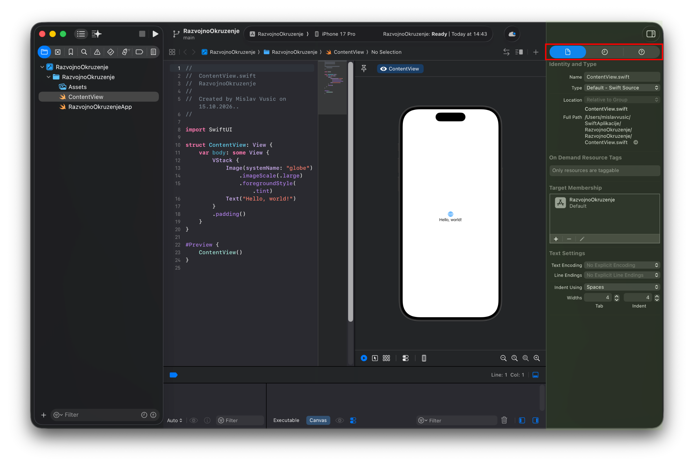</a>

Za datoteke koje se prate sustavom Git u Inspectoru je dostupan pregled povijesti promjena. Odabirom odgovarajuće kartice prikazuju se commitovi povezani s odabranom datotekom. Commit predstavlja zabilježeno stanje odabranih promjena u repozitoriju, uz poruku koja opisuje što je promijenjeno. Na slici je prikazan početni commit projekta. Ovaj pregled olakšava praćenje razvoja datoteke i pronalaženje prethodno spremljenih promjena.

<a href="Documentation/18-povijest-promjena-datoteke.png">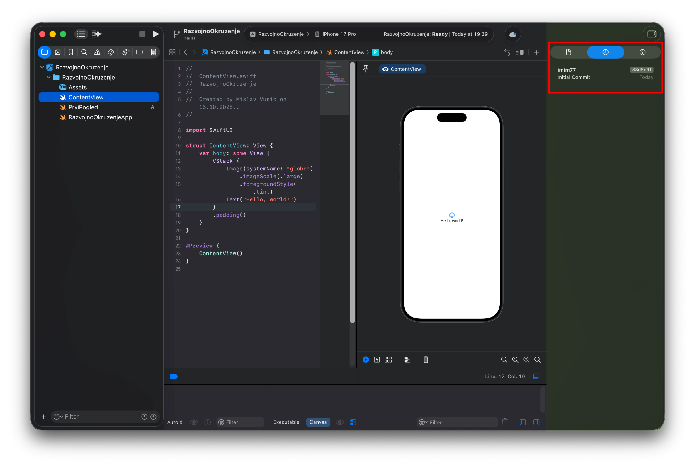</a>

## 4. Rad s datotekama i pretraživanje projekta

Na lijevoj strani prozora nalazi se **Project navigator**, koji se otvara klikom na ikonu mape. U njemu su prikazane datoteke i mape koje pripadaju projektu. Datoteka `ContentView.swift` sadrži početni SwiftUI pogled, dok se u katalogu `Assets` pohranjuju resursi poput slika, boja i ikone aplikacije. Datoteka čiji naziv završava s `App.swift` definira ulaznu točku aplikacije i njezin početni sadržaj. Klikom na naziv samog projekta otvaraju se njegove postavke, u kojima se mogu uređivati ciljevi aplikacije i konfiguracija izgradnje.

<a href="Documentation/19-navigator-projekta.png">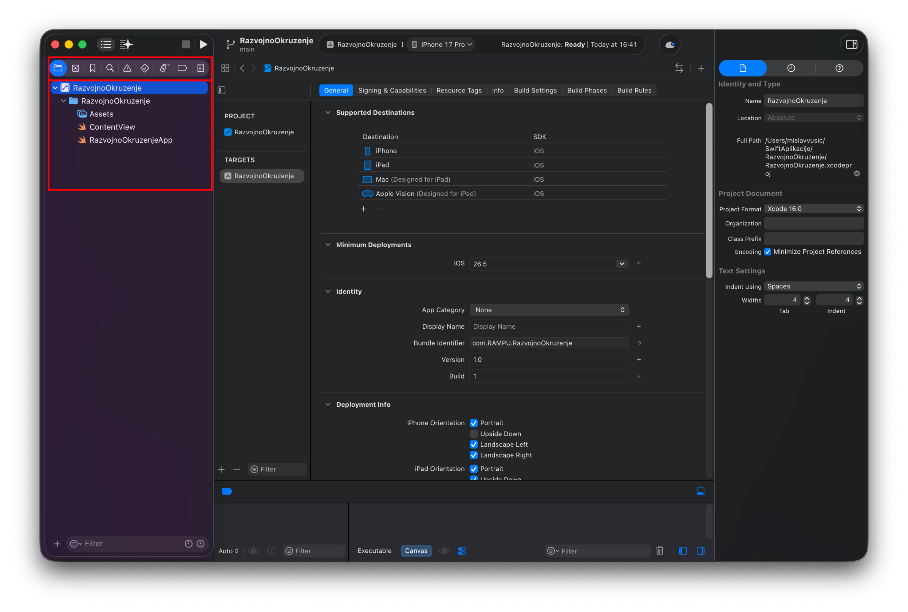</a>

Nova datoteka dodaje se odabirom mape aplikacije u Project navigatoru i klikom na gumb **+** pri dnu tog područja. Nakon toga otvara se izbornik s mogućnostima dodavanja sadržaja u projekt. U prikazanom primjeru odabire se opcija **New File from Template**, koja omogućuje stvaranje datoteke na temelju gotovog predloška. Na taj način Xcode priprema osnovnu strukturu datoteke, pa programer može nastaviti s uređivanjem njezina sadržaja.

<a href="Documentation/20-dodavanje-datoteke-u-projekt.png">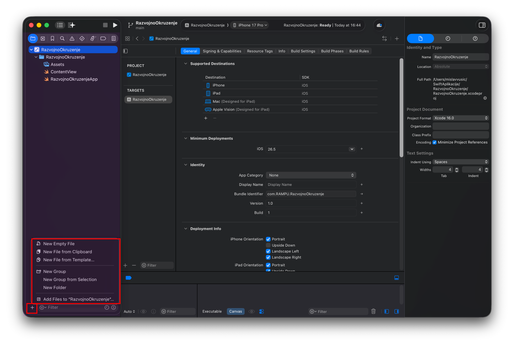</a>

Nakon odabira naredbe za novu datoteku otvara se prozor s dostupnim predlošcima. U gornjem dijelu odabire se platforma **iOS**, a zatim predložak **SwiftUI View**, koji služi za izradu zasebnog pogleda korisničkog sučelja. Taj predložak sadrži početni SwiftUI kod i pripremu za prikaz pogleda u previewu. Klikom na gumb **Next** nastavlja se na unos naziva i odabir lokacije nove datoteke.

<a href="Documentation/21-odabir-predloska-swiftui-view.png">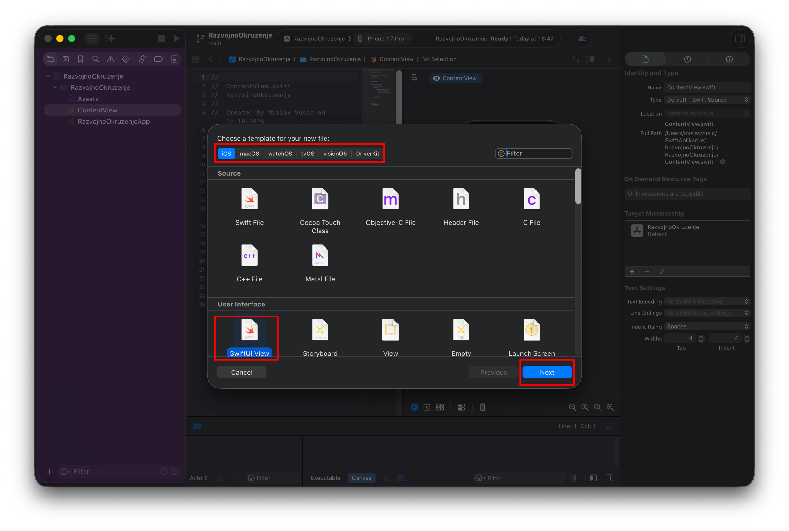</a>

U sljedećem prozoru određuje se naziv datoteke i mjesto na kojem će biti spremljena. U ovom primjeru pogled je nazvan `PrviPogled`, pa se stvara datoteka `PrviPogled.swift`. Prije spremanja provjerava se odabrana mapa i pripadnost targetu aplikacije kako bi datoteka bila uključena u odgovarajući cilj projekta. Klikom na gumb **Create** Xcode stvara datoteku i dodaje je u Project navigator, nakon čega se njezin sadržaj može otvoriti i uređivati.

<a href="Documentation/22-spremanje-novog-pogleda.png">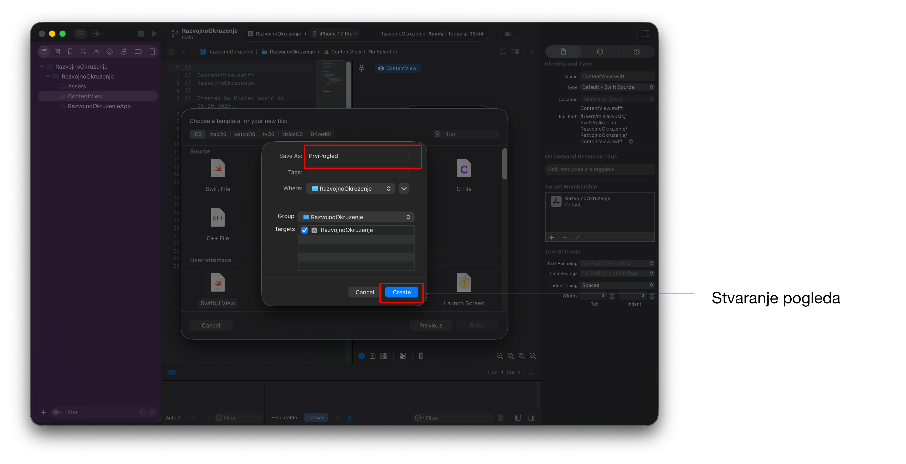</a>

Za pretraživanje sadržaja projekta koristi se **Find navigator**, koji se otvara klikom na karticu s ikonom povećala ili prečacem **⌘⇧F**. U polje za pretraživanje unosi se željeni pojam, u ovom primjeru `PrviPogled`. Uz pojam moguće je odrediti i opseg pretraživanja, odnosno projekt ili grupu unutar koje se traži podudaranje. Nakon potvrde tipkom **Return** Xcode pretražuje odabrani sadržaj i prikazuje pronađene rezultate.

<a href="Documentation/39-pretrazivanje-projekta.png">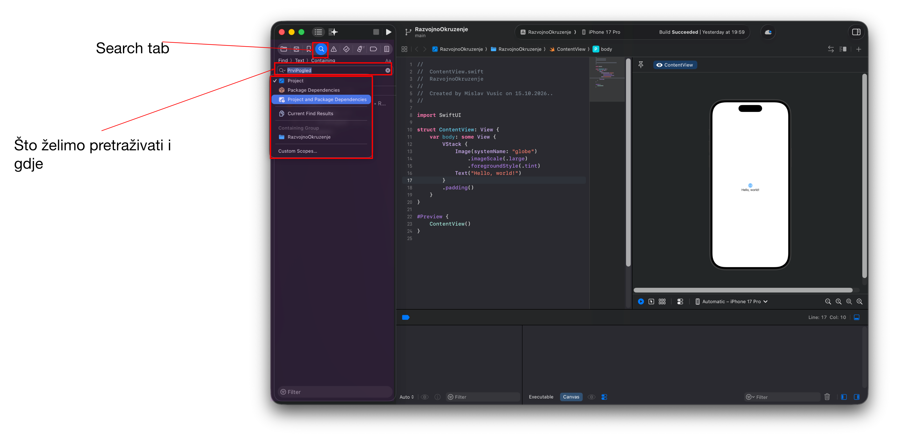</a>

Rezultati pretraživanja prikazuju se u lijevom panelu i grupirani su prema datotekama u kojima je pronađen traženi pojam. Klikom na pojedini rezultat otvara se odgovarajuća datoteka u editoru i označava mjesto podudaranja. U prikazanom primjeru pretražuje se naziv `PrviPogled`, koji se pojavljuje u definiciji pogleda i njegovu previewu, a može se pojaviti i u početnoj sceni aplikacije ako je ondje postavljen. Ovaj način pretraživanja olakšava pronalaženje povezanih dijelova koda kada projekt sadrži veći broj datoteka.

<a href="Documentation/40-rezultati-pretrazivanja.png">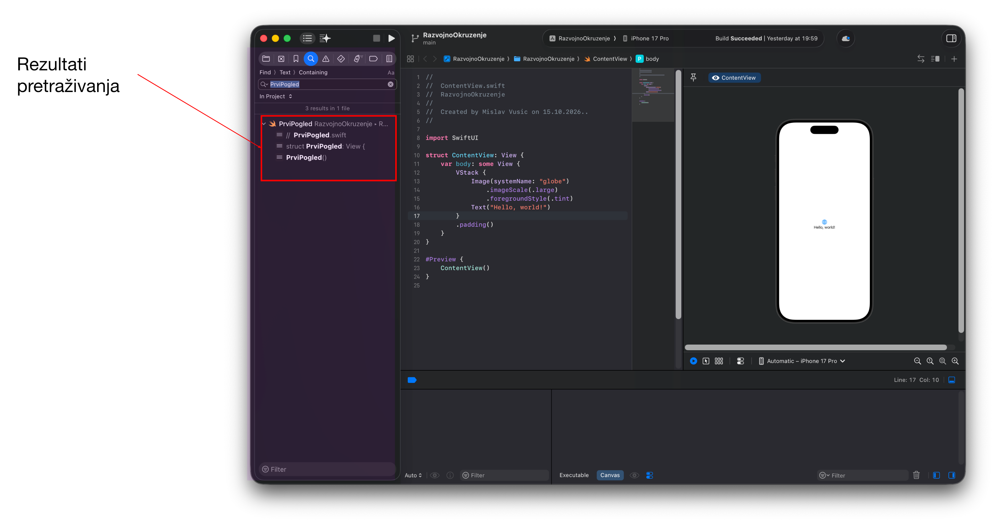</a>

## 5. Izrada i pregled SwiftUI sučelja

Otvaranjem datoteke `PrviPogled.swift` u središnjem dijelu prozora prikazuje se njezin programski kod. To područje naziva se **Editor** i koristi se za pisanje i uređivanje sadržaja datoteka. Uz kod se može prikazati i preview korisničkog sučelja. Ako je potrebno više prostora za rad, Inspector se može sakriti klikom na označeni gumb u gornjem desnom kutu prozora. Ponovnim klikom na istu kontrolu desni panel ponovno postaje vidljiv.

<a href="Documentation/23-editor-area.png">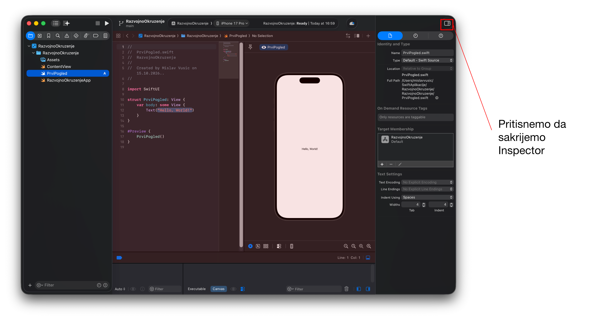</a>

Na sljedećoj slici prikazan je raspored u kojem se kod nalazi s lijeve strane, a njegov vizualni prikaz s desne. Područje za pregled sučelja naziva se **Canvas** i omogućuje provjeru izgleda SwiftUI pogleda tijekom razvoja. Promjenom teksta ili rasporeda elemenata u kodu te osvježavanjem previewa može se odmah vidjeti rezultat izmjene. Time se olakšava oblikovanje sučelja jer za svaku promjenu nije potrebno zasebno pokretati cijelu aplikaciju.

Na kraju datoteke nalazi se makronaredba `#Preview`, koja određuje pogled prikazan u Canvasu. Ako Canvas nije vidljiv, uključuje se opcijom **Editor > Canvas**, a pauzirani preview potrebno je nastaviti ili ponovno pokrenuti kako bi se prikaz ažurirao.

<a href="Documentation/24-editor-area.png">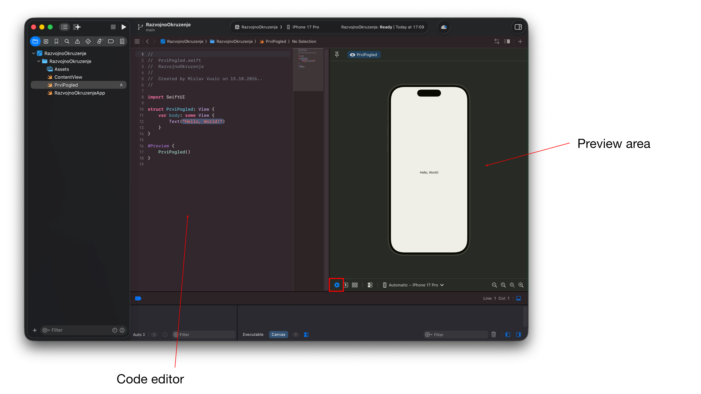</a>

Pri dnu Canvasa nalazi se izbornik za odabir uređaja na kojem se prikazuje preview. Klikom na taj izbornik otvara se popis dostupnih modela, a odabirom pojedinog uređaja prikaz se prilagođava njegovim dimenzijama zaslona. Ova mogućnost olakšava provjeru rasporeda elemenata na različitim veličinama ekrana. Odabrani uređaj odnosi se na prikaz u Canvasu, dok se uređaj za pokretanje cijele aplikacije naredbom **Run** bira zasebno u gornjoj alatnoj traci.

<a href="Documentation/25-odabir-uredaja-za-preview.png">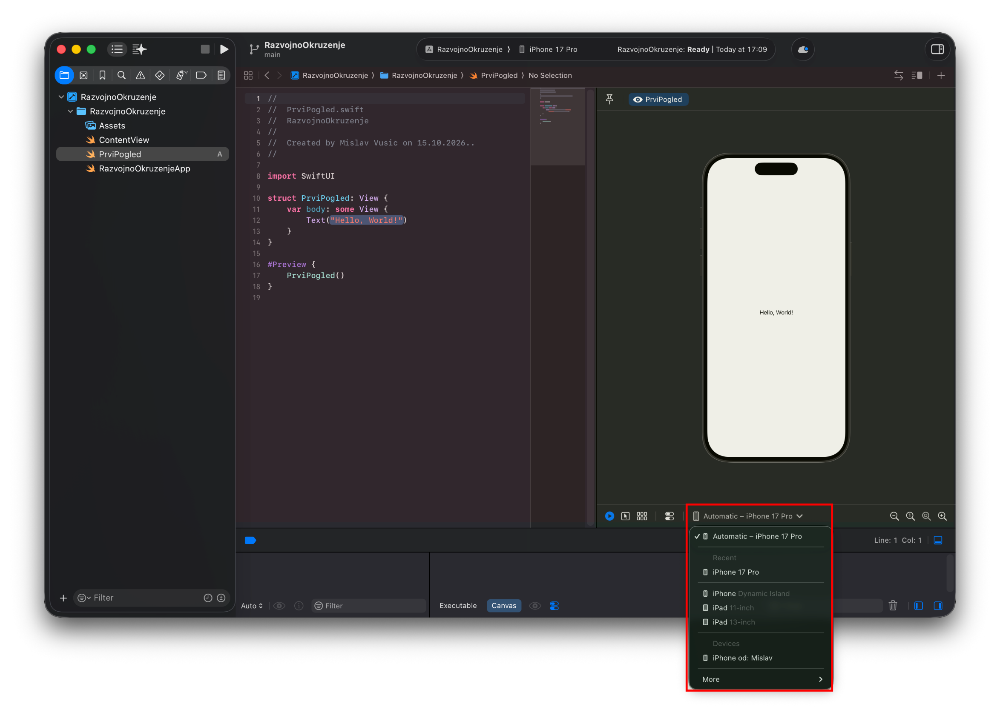</a>

Canvas omogućuje i odabir pojedinih elemenata prikazanog sučelja. Na slici je označena kontrola **Selectable preview**, kojom se uključuje način rada za odabir elemenata u prikazu. Na taj način programer može lakše povezati odabranu komponentu s pripadajućim dijelom koda i pratiti kako je sučelje sastavljeno. Za provjeru radnji, primjerice pritiska na gumb, koristi se interaktivni način rada **Live preview**, u kojem se može isprobati ponašanje prikazanog pogleda.

<a href="Documentation/26-odabir-elemenata-u-previewu.png">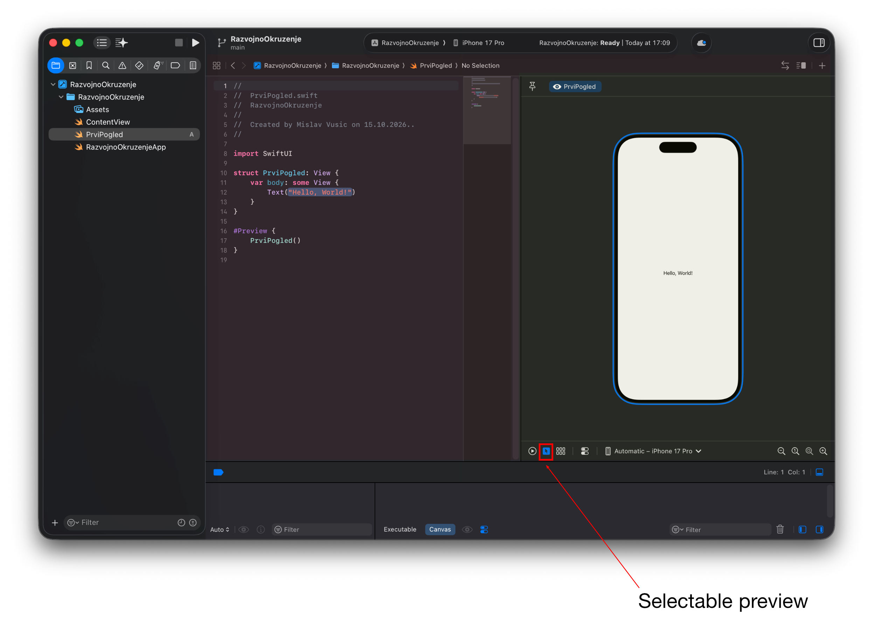</a>

Xcode sadrži biblioteku gotovih komponenti korisničkog sučelja koja se naziva **Library**. Otvara se naredbom **View > Show Library**, nakon čega je moguće pretraživati dostupne elemente i pregledavati njihov način uporabe. U prikazanom primjeru odabrana je komponenta **Button**, odnosno gumb. Uz odabrani element prikazuje se opis i primjer koda, što olakšava njegovo dodavanje u SwiftUI pogled. Kontrole pri vrhu prozora služe za promjenu kategorije sadržaja koji se pregledava u biblioteci.

<a href="Documentation/27-biblioteka-swiftui-komponenti.png">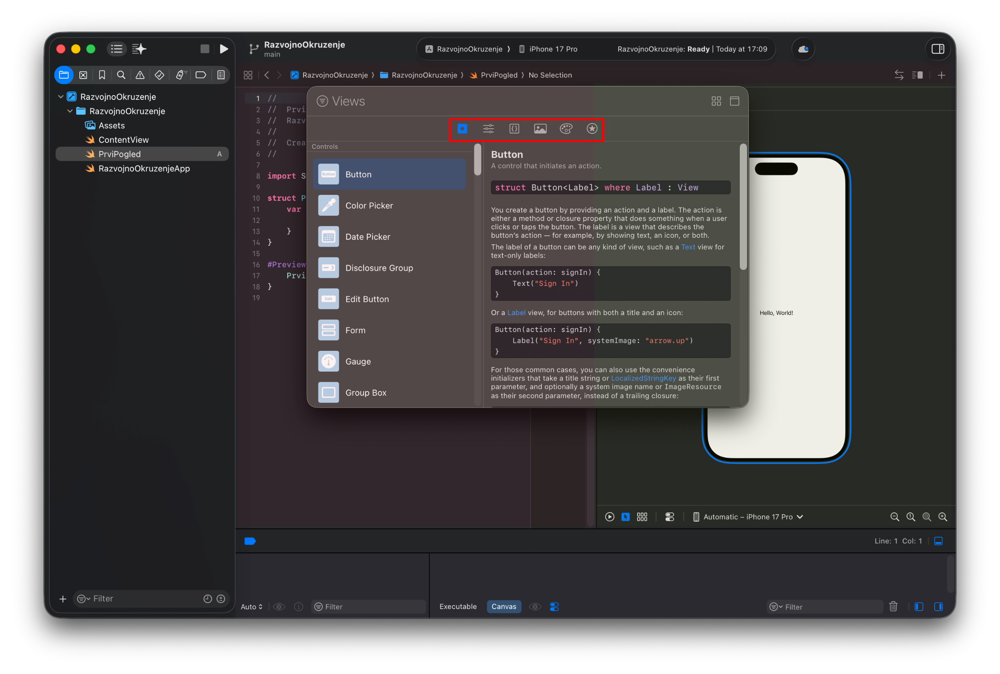</a>

Na sljedećoj slici prikazana je komponenta **Button** unutar koda i odgovarajući gumb u previewu. U SwiftUI kodu određuju se sadržaj gumba i radnja koja se izvodi nakon njegova pritiska, dok Canvas prikazuje njegov izgled i položaj u odnosu na ostale elemente sučelja. Usporedni prikaz koda i previewa omogućuje jednostavnije praćenje promjena tijekom uređivanja. U načinu **Live preview** može se provjeriti i reagira li gumb u skladu s definiranom radnjom.

<a href="Documentation/28-dodavanje-gumba-u-pogled.png">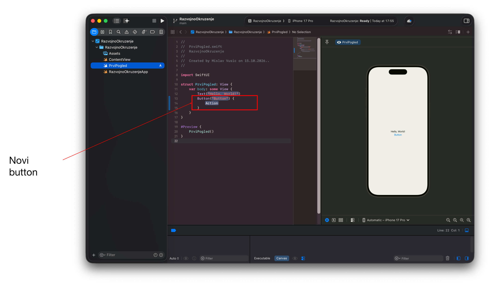</a>

Prilikom oblikovanja korisničkog sučelja potrebno je provjeriti kako aplikacija izgleda u svijetlom i tamnom načinu rada. U Canvasu se za to koristi izbornik varijanti prikaza i opcija **Color Scheme Variants**. Njezinim odabirom moguće je usporedno prikazati isti pogled u oba načina rada, kao što je vidljivo na sljedećoj slici. Na taj način programer može provjeriti čitljivost teksta, kontrast boja i vidljivost pojedinih kontrola. Takva usporedba olakšava uočavanje elemenata koje je potrebno prilagoditi kako bi sučelje ostalo pregledno u oba načina prikaza.

<a href="Documentation/41-svijetli-i-tamni-prikaz.png">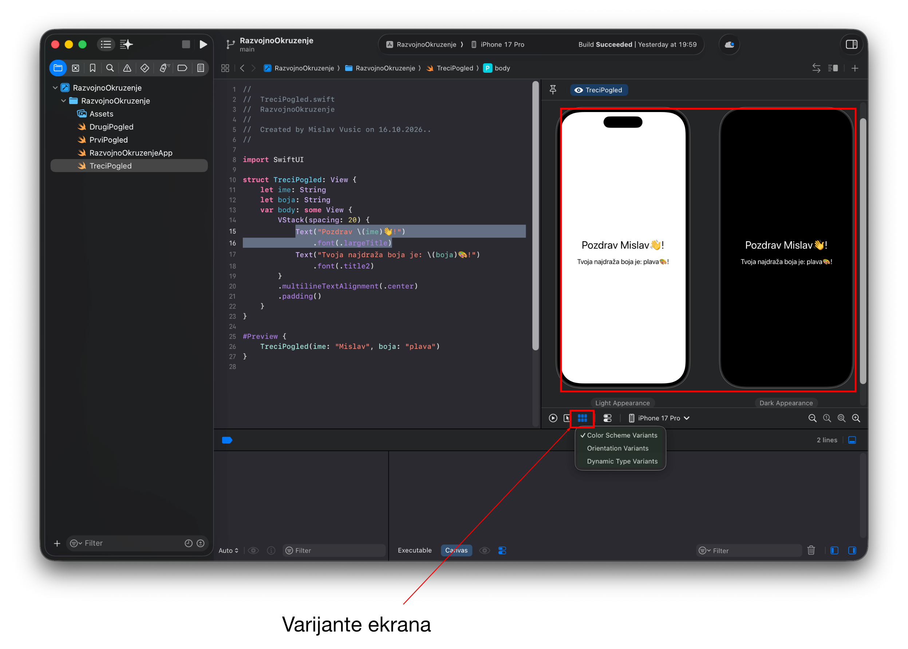</a>

## 6. Pogreške u kodu i izvještaji izgradnje

Tijekom pisanja programskog koda mogu se pojaviti pogreške koje onemogućuju uspješnu izgradnju aplikacije ili previewa. U prikazanom primjeru poziv komponente **Button** nije potpun jer nedostaju potrebni argumenti. Xcode označava problem uz odgovarajući redak koda, dok se u području previewa pojavljuje poruka o neuspjeloj izgradnji. Takve oznake pomažu programeru da brzo pronađe dio koda koji je potrebno ispraviti.

<a href="Documentation/29-pogreska-u-kodu-i-previewu.png">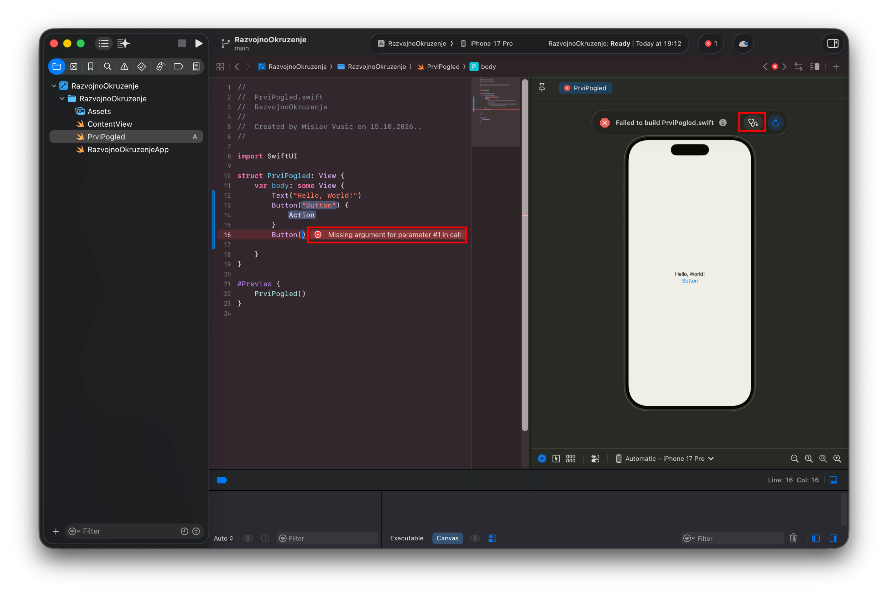</a>

Klikom na označenu kontrolu uz poruku o neuspjeloj izgradnji otvara se detaljniji prikaz dijagnostike. U njemu se nalaze naziv datoteke, redak na kojem je problem uočen i opis pogreške. Na slici je prikazana poruka koja upućuje na nedostajući argument u pozivu komponente. Na temelju tih podataka programer može povezati poruku s odgovarajućim mjestom u kodu i odrediti potrebnu izmjenu. Točan sadržaj poruke ovisi o vrsti pogreške i verziji razvojnog okruženja.

<a href="Documentation/30-dijagnostika-pogreske.png">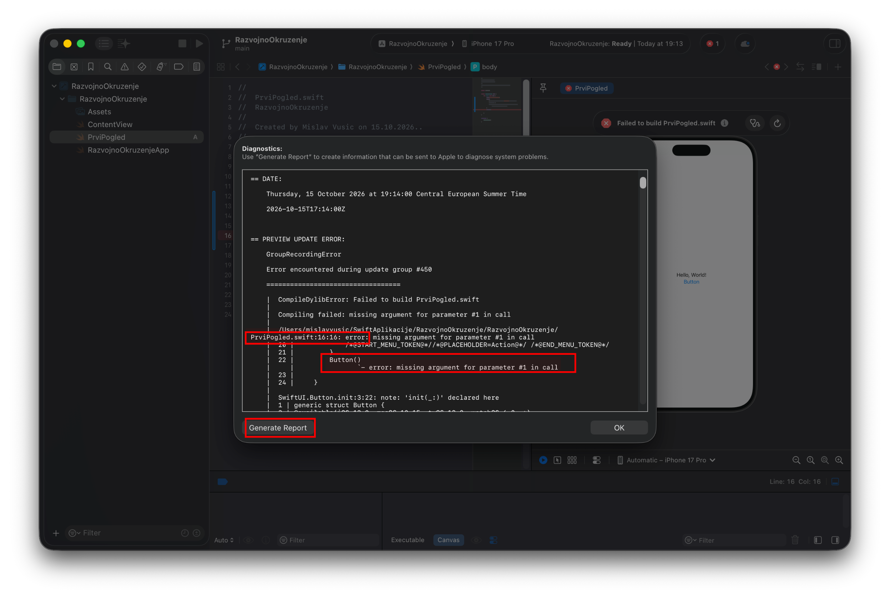</a>

Zapisi prethodnih izgradnji dostupni su u području **Report navigator**, koje je na slici označeno nazivom „Build tab”. Odabirom neuspjelog zapisa **Build** otvara se izvještaj o toj izgradnji. U njemu je moguće pratiti korake koje je Xcode izvršavao i pronaći mjesto na kojem je došlo do problema. Za pregled trenutačnih upozorenja i pogrešaka koristi se zasebni **Issue navigator**, dok Report navigator zadržava izvještaje pojedinih postupaka izgradnje.

<a href="Documentation/31-pregled-pogresaka-pri-izgradnji.png">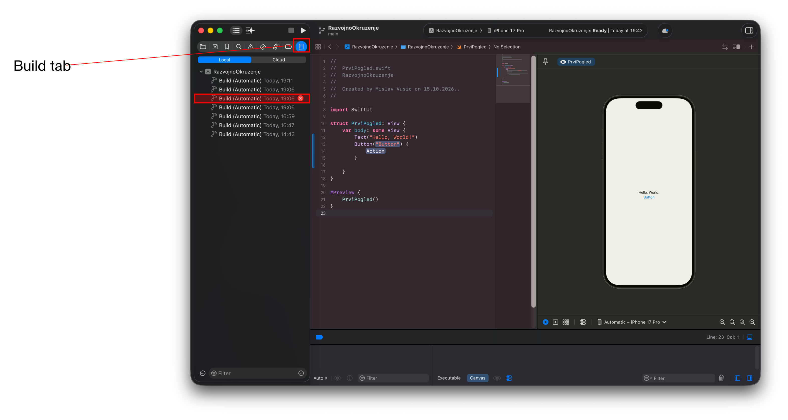</a>

Proširivanjem zapisa izgradnje prikazuju se pojedini koraci i poruke povezane s njihovim izvršavanjem. Na sljedećoj slici označen je korak koji nije uspješno završen. Nakon pregleda poruke programer se vraća u datoteku `PrviPogled.swift` i ispravlja nepotpuni poziv komponente. Zatim se ponovno pokreće izgradnja ili osvježava preview kako bi se provjerilo je li problem uklonjen.

<a href="Documentation/32-izvjestaj-o-izgradnji-projekta.png">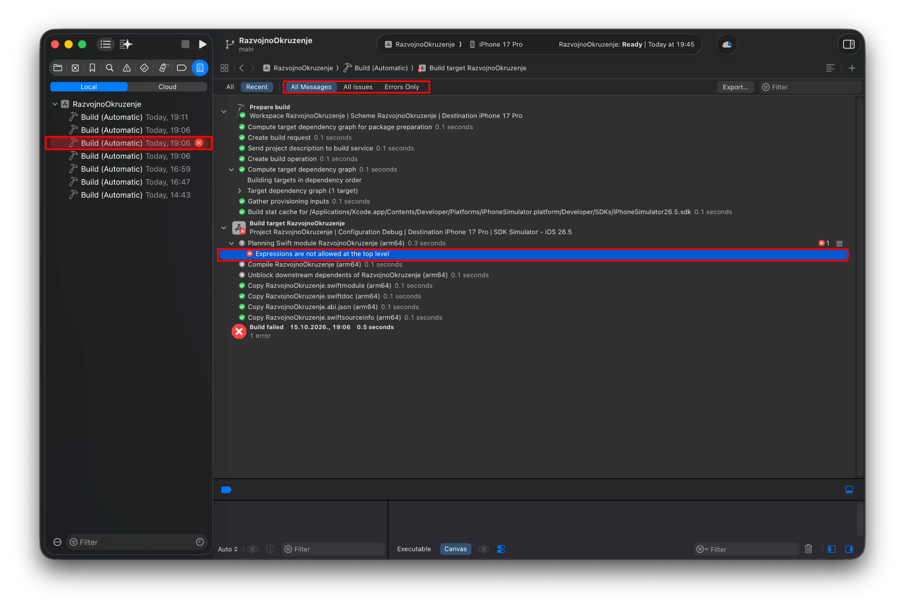</a>

Uspješan završetak nove izgradnje i ponovno prikazivanje pogleda u previewu potvrđuju da je pogreška ispravljena. Pri analizi je korisno krenuti od prve relevantne poruke jer jedan problem u kodu može uzrokovati više povezanih poruka o pogreškama.

## 7. Izgradnja i pokretanje aplikacije na simulatoru

Prije pokretanja aplikacije potrebno je razlikovati pogled prikazan u previewu od početnog pogleda same aplikacije. Preview prikazuje sadržaj određen makronaredbom `#Preview` u otvorenoj datoteci. Početni sadržaj pokrenute aplikacije definira se u datoteci čiji naziv završava s `App.swift`, unutar početne scene aplikacije. Ako se želi prikazati novoizrađeni `PrviPogled`, potrebno ga je postaviti kao sadržaj te scene. Samo otvaranje datoteke u editoru ne mijenja pogled koji će se prikazati nakon pokretanja aplikacije.

Izgradnja projekta pokreće se odabirom opcije **Product > Build** ili tipkovničkim prečacem **⌘B**. Tijekom tog postupka Xcode prevodi izvorni kod, povezuje potrebne dijelove projekta i priprema aplikaciju za odabrano odredište. Naredba Build omogućuje provjeru može li se projekt uspješno izgraditi, bez pokretanja aplikacije. Ako postupak završi bez pogrešaka, aplikacija je spremna za sljedeći korak, odnosno pokretanje na simulatoru ili fizičkom uređaju.

<a href="Documentation/33-izgradnja-i-pokretanje-aplikacije.png">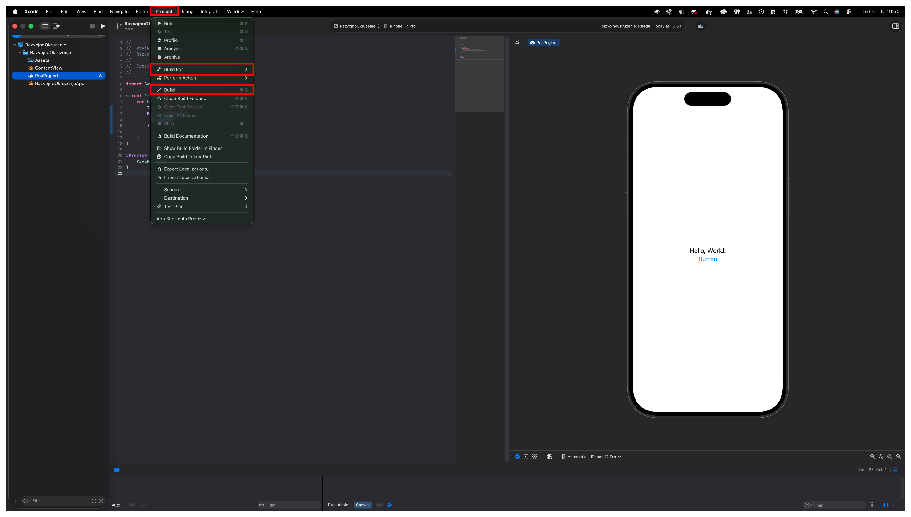</a>

U izborniku **Product** nalazi se i opcija **Build For**, koja omogućuje pripremu izgradnje za određenu namjenu. Na slici su prikazane mogućnosti **Running**, **Testing** i **Profiling**. Running priprema aplikaciju za pokretanje, Testing za izvođenje testova, a Profiling za analizu rada i performansi aplikacije. Odabirom pojedine mogućnosti provodi se odgovarajuća priprema, dok se za uobičajenu izgradnju i pokretanje ovog primjera koristi naredba **Run**.

<a href="Documentation/34-pokretanje-uz-dijagnostiku.png">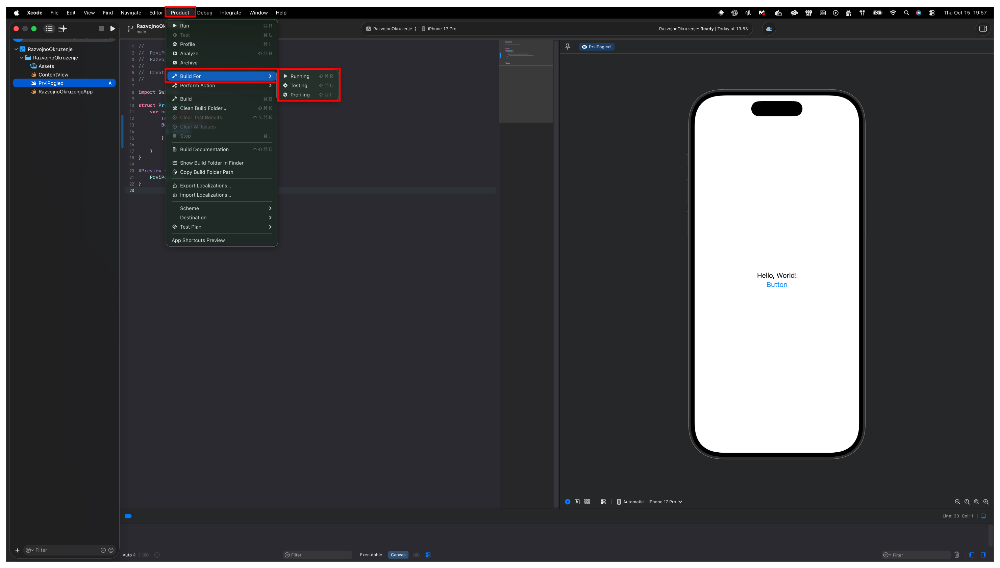</a>

Nakon odabira sheme i željenog iPhone simulatora aplikacija se pokreće klikom na trokutasti gumb **Run** u gornjoj alatnoj traci ili prečacem **⌘R**. Xcode najprije pokreće izgradnju projekta, a nakon uspješnog završetka instalira i otvara aplikaciju na odabranom simulatoru. Programer tada može provjeriti izgled sučelja i isprobati dostupne radnje. Za završetak trenutačne sesije koristi se kvadratni gumb **Stop** ili naredba **Product > Stop**.

<a href="Documentation/35-pokretanje-na-simulatoru.png">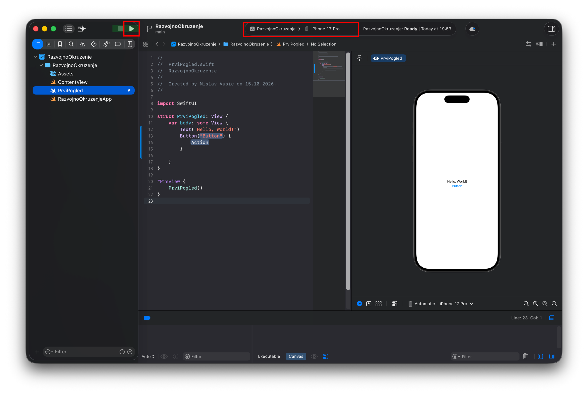</a>

Na sljedećoj slici prikazana je aplikacija otvorena u zasebnom prozoru **Simulatora**. Simulator predstavlja virtualni uređaj na kojem se mogu provjeravati izgled i ponašanje aplikacije tijekom razvoja. Interakcija se obavlja mišem i tipkovnicom, pa se mogu pritiskati gumbi, unositi tekst i prelaziti između zaslona. U traci izbornika Simulatora nalaze se dodatne kontrole uređaja, među kojima su mogućnosti promjene orijentacije. Tako se može provjeriti prilagođava li se sučelje različitim položajima zaslona.

<a href="Documentation/36-kontrole-simulatora.png">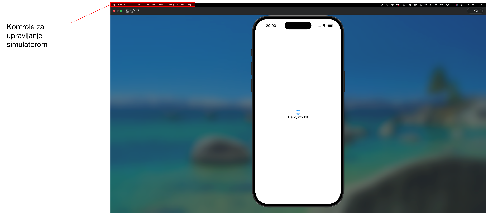</a>

## 8. Verzioniranje projekta pomoću Gita

Xcode omogućuje praćenje promjena projekta pomoću sustava **Git**. U području **Source Control navigator**, koje je na slici označeno kao „Git tab”, kartica **Changes** prikazuje datoteke promijenjene od posljednjeg commita. Oznaka **A** označava novu datoteku, a oznaka **M** datoteku čiji je sadržaj izmijenjen. Takav pregled omogućuje programeru da prije spremanja promjena provjeri koje su datoteke dodane ili uređene.

Za bilježenje odabrane cjeline promjena koristi se opcija **Integrate > Commit**. Nakon pregleda i odabira promjena unosi se poruka koja opisuje njihov sadržaj te se stvara commit. Time se promjene bilježe u lokalnoj povijesti repozitorija na Macu, dok se za njihovo slanje u udaljeni repozitorij koristi naredba **push**.

<a href="Documentation/37-git-i-promjene-u-projektu.png">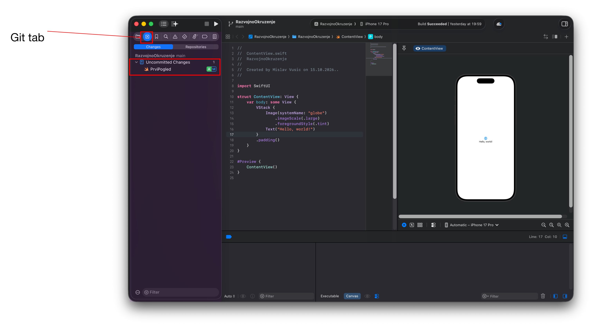</a>

Na kartici **Repositories** prikazuju se repozitoriji povezani s projektom. Proširivanjem repozitorija i stavke **Branches** otvara se popis dostupnih grana. U prikazanom primjeru odabrana je grana `main`, uz koju je moguće pregledati pripadajuću povijest commitova. Grane omogućuju odvojeni rad na pojedinim promjenama ili novim funkcionalnostima prije njihova spajanja s glavnom granom. Na taj se način lakše organizira razvoj i prati povijest projekta.

<a href="Documentation/38-git-grane-i-repozitorij.png">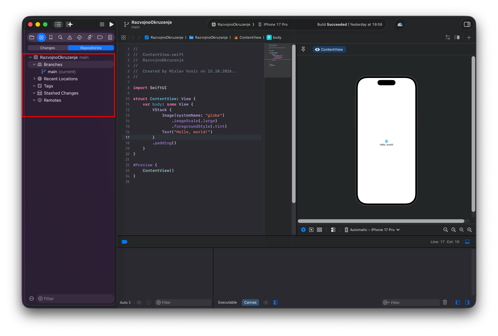</a>

## 9. Priprema i pokretanje aplikacije na iPhoneu

Osim na simulatoru, aplikaciju je moguće pokrenuti i na fizičkom iPhoneu. Takav način rada omogućuje provjeru izgleda i ponašanja aplikacije na stvarnom uređaju. Prije prvog pokretanja potrebno je povezati uređaj s Macom, omogućiti developerski način rada i urediti postavke potpisivanja aplikacije u Xcodeu. U nastavku je prikazan taj postupak i rezultat pokretanja aplikacije na telefonu.

Prvi korak je povezivanje iPhonea s Macom i potvrda uparivanja, odnosno povjerenja između uređaja i računala kada se pojavi odgovarajući upit. Nakon toga na iPhoneu se otvaraju **Postavke > Privatnost i sigurnost > Developerski način rada**. Uključivanjem ove opcije omogućuje se korištenje uređaja za razvoj i testiranje aplikacija kroz Xcode.

Nakon uključivanja potrebno je ponovno pokrenuti iPhone i potvrditi aktivaciju developerskog načina rada. Ako opcija još nije prikazana u postavkama, najprije se započinje uparivanje uređaja s Macom. Na sljedećoj slici označeno je mjesto na kojem se opcija nalazi unutar postavki privatnosti i sigurnosti.

<a href="Documentation/42-ukljucivanje-developerskog-nacina-rada.png">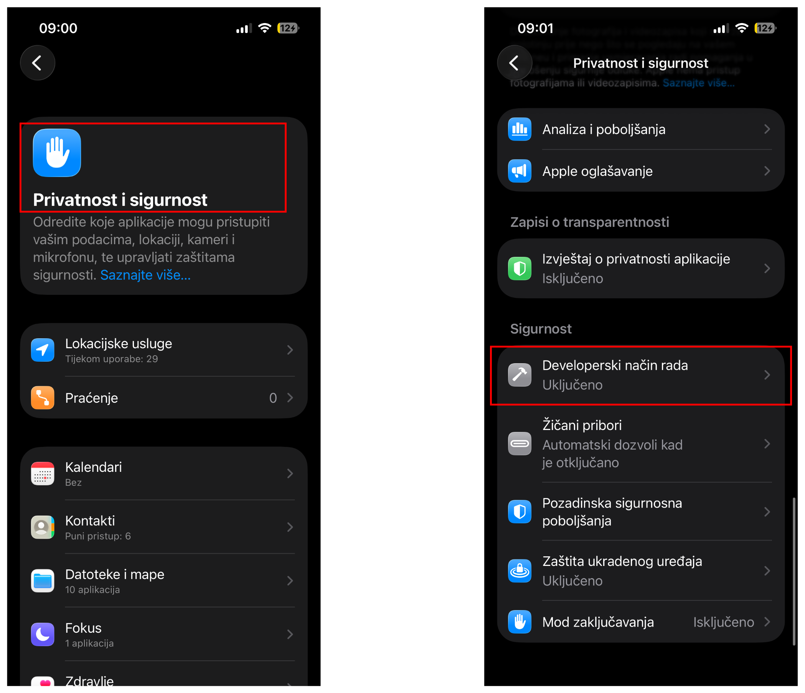</a>

Nakon pripreme iPhonea u Xcodeu se otvara izbornik odredišta pokretanja u gornjoj alatnoj traci. U popisu dostupnih fizičkih uređaja odabire se povezani iPhone, kao što je označeno na slici. Time se određuje da će se sljedeće pokretanje aplikacije izvršiti na telefonu. Pri prvom povezivanju Xcode može provoditi dodatnu pripremu uređaja, pa je prije pokretanja potrebno pričekati da taj postupak završi.

<a href="Documentation/43-odabir-fizickog-uredaja.png">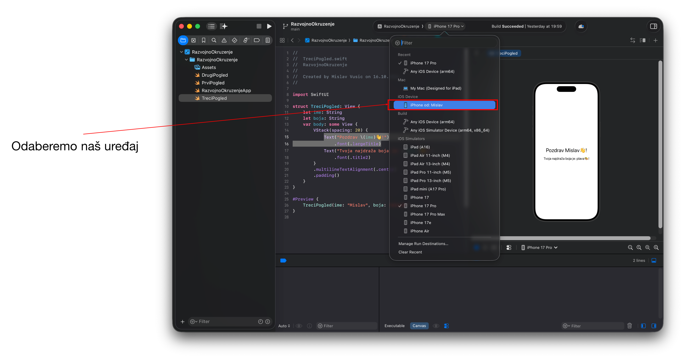</a>

Za pokretanje aplikacije na fizičkom uređaju potrebno je urediti postavke potpisivanja. U Project navigatoru odabire se projekt, zatim target aplikacije i kartica **Signing & Capabilities**. Uključuje se opcija **Automatically manage signing**, kojom Xcode automatski upravlja potrebnim postavkama potpisivanja. U polju **Team** odabire se razvojni tim povezan s Apple računom, odnosno **Personal Team** ako je dostupan za osobni račun.

Ako račun nije dodan, prijava se obavlja kroz **Xcode > Settings > Apple Accounts**. Projekt također mora imati vlastiti jedinstveni **Bundle Identifier**. Nakon odabira tima i rješavanja eventualnih poruka o potpisivanju aplikacija se pokreće gumbom **Run**, čime započinje njezina izgradnja i instalacija na odabrani iPhone.

<a href="Documentation/44-potpisivanje-aplikacije-i-apple-racun.png">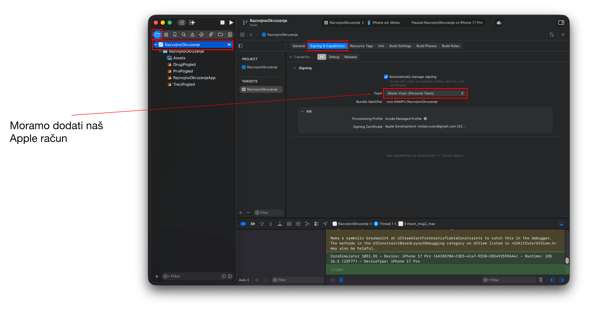</a>

Nakon uspješne izgradnje i instalacije aplikacija se pojavljuje na iPhoneu. Na sljedećoj slici njezina je ikona označena crvenim okvirom i strelicom. Ako u projektu nije postavljena vlastita ikona, na početnom zaslonu može se prikazivati generička ikona aplikacije. Pritiskom na ikonu otvara se instalirana aplikacija i omogućuje provjera njezina rada na telefonu.

<a href="Documentation/45-prikaz-aplikacije-na-mobitelu.png">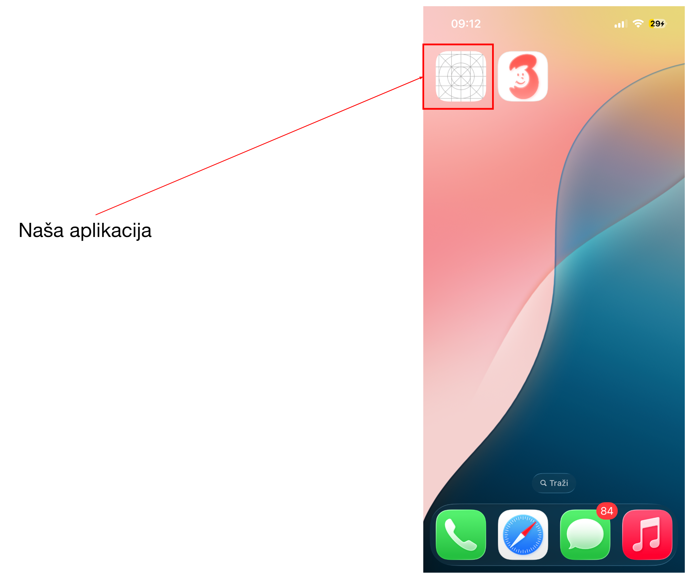</a>

Na sljedećoj slici prikazana su tri zaslona aplikacije pokrenute na fizičkom iPhoneu. Na početnom zaslonu nalazi se poruka dobrodošlice i gumb za nastavak. Pritiskom na taj gumb otvara se pogled za unos podataka, u kojem korisnik unosi ime i najdražu boju. Nakon potvrde prikazuje se zaslon s pozdravnom porukom i prethodno unesenim podacima.

Ovaj primjer prikazuje prijelaz između pogleda i korištenje korisničkog unosa za oblikovanje sadržaja sljedećeg zaslona. Pokretanjem na stvarnom uređaju moguće je provjeriti raspored elemenata, rad tipkovnice i odgovara li prikazani rezultat unesenim vrijednostima.

<a href="Documentation/46-prikaz-aplikacije-na-mobitelu.png">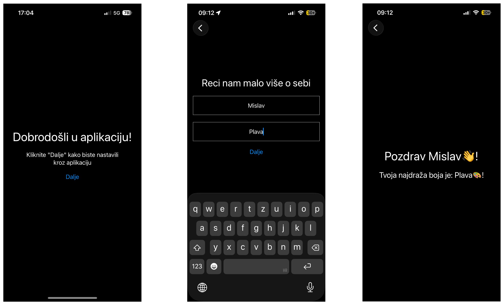</a>

## 10. Praćenje izvršavanja i analiza sučelja

**Debugger** je alat kojim se prati izvršavanje aplikacije i istražuju uzroci pogrešaka tijekom njezina rada. Jedan od osnovnih postupaka je postavljanje točke prekida, odnosno **breakpointa**, klikom na rub editora uz željeni izvršivi redak koda. Nakon pokretanja aplikacije gumbom **Run** i izvođenja radnje koja dolazi do tog retka, Xcode privremeno zaustavlja izvršavanje. Programer tada može pregledati trenutačne vrijednosti varijabli i utvrditi kojim je putem aplikacija došla do označenog mjesta.

Na slici su označeni **Debug navigator** na lijevoj strani, breakpoint u editoru i kontrole izvršavanja pri dnu prozora. Kontrola **Continue** nastavlja izvođenje do sljedeće točke prekida ili završetka radnje. **Step Over** izvršava sljedeći redak bez ulaska u pozvanu funkciju, **Step Into** omogućuje ulazak u pozvanu funkciju kada je to moguće, a **Step Out** nastavlja izvođenje do izlaska iz trenutačne funkcije. Te kontrole omogućuju postupno praćenje toka programa.

U donjem području **Debug area** prikazuju se dostupne varijable i konzola s porukama aplikacije i sustava. Ako to područje nije vidljivo, otvara se naredbom **View > Debug Area > Show Debug Area**. Pregled vrijednosti i poruka tijekom zaustavljenog izvršavanja pomaže u povezivanju ponašanja aplikacije s odgovarajućim dijelovima koda.

<a href="Documentation/47-debugger.png">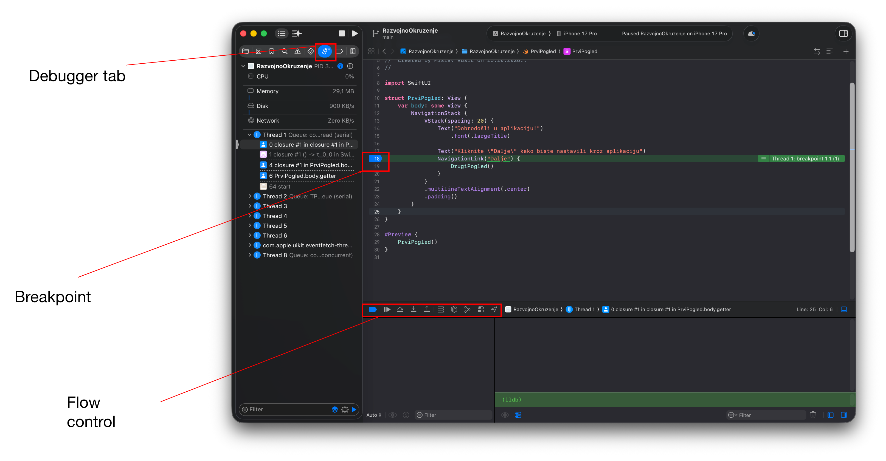</a>

Za istraživanje rasporeda elemenata u pokrenutoj aplikaciji koristi se alat **Debug View Hierarchy**. Dok aplikacija prikazuje željeni zaslon, klikom na odgovarajuću kontrolu u donjoj debug traci snima se trenutačno stanje sučelja i otvara pregled njegove hijerarhije. Na slici se s lijeve strane nalazi stablo elemenata, dok je u središnjem dijelu prikazan njihov raspored po slojevima.

Odabirom pojedinog elementa u stablu ili prikazu moguće je istražiti njegov položaj i veličinu. Takav pregled koristan je kada se elementi preklapaju, kada su razmaci neočekivani ili kada neki sadržaj nije vidljiv. Nakon završetka analize izvođenje aplikacije može se nastaviti ili se sesija može zaustaviti gumbom **Stop**.

<a href="Documentation/48-debugger-i-hijerarhija-pogleda.png">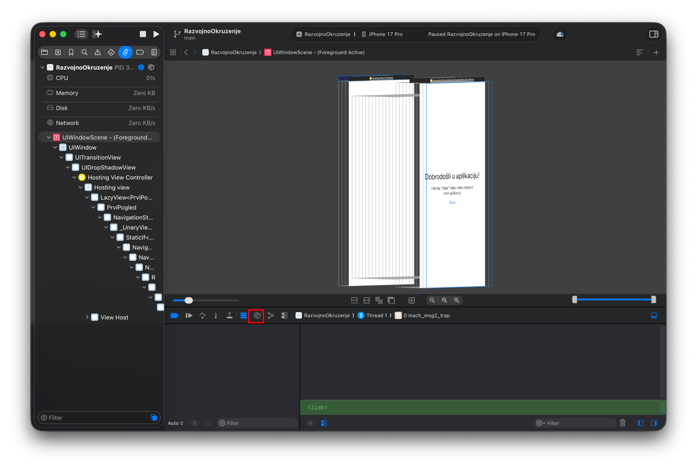</a>

## 11. Životni ciklus SwiftUI aplikacije

Životni ciklus opisuje ponašanje aplikacije od pokretanja, preko korištenja i odlaska u pozadinu, do ponovnog otvaranja ili završetka rada. Tijekom tih prijelaza potrebno je prilagoditi izvršavanje zadataka, osloboditi nepotrebne resurse i sačuvati podatke korisnika. U SwiftUI aplikaciji pritom se razlikuju razina aplikacije, razina scene i razina pojedinog pogleda.

### 11.1. Ulazna točka, scena i hijerarhija pogleda

Na sljedećoj slici prikazan je odnos osnovnih dijelova SwiftUI aplikacije. Vanjski okvir predstavlja **proces aplikacije**, kojim upravlja operacijski sustav. Unutar njega nalazi se struktura označena atributom **`@main`**, koja predstavlja ulaznu točku aplikacije i implementira protokol **`App`**. U projektu iz prethodnih poglavlja ta se struktura nalazi u datoteci `RazvojnoOkruzenjeApp.swift`. SwiftUI aplikacija ima jednu glavnu ulaznu točku, a njezino svojstvo `body` opisuje scene koje aplikacija koristi.

**Scena (`Scene`)** povezuje životni ciklus dijela korisničkog sučelja s njegovim sadržajem. U prikazanom projektu koristi se **`WindowGroup`**, vrsta scene koja određuje hijerarhiju pogleda za prozore aplikacije. Pogled naveden unutar `WindowGroup` predstavlja početak te hijerarhije, a njegovi podpogledi oblikuju ostatak sučelja. Na platformama koje podržavaju više prozora, poput iPadOS-a, isti `WindowGroup` može služiti kao predložak za više prozora, pri čemu svaki ima vlastito lokalno stanje pogleda..

<a href="Documentation/49-zivotni-ciklus-ios-aplikacije-1.png">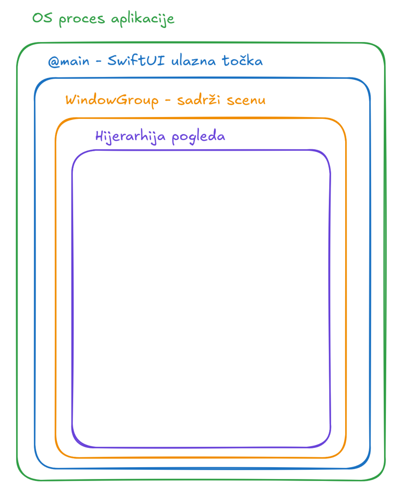</a>

### 11.2. Aktivnost scene i prijelaz u pozadinu

Druga slika prikazuje prijelaze između stanja scene u iOS-u. **Unattached** označava scenu koja još nije povezana s aplikacijom. Pri otvaranju sučelja scena prelazi u prednji plan i postaje aktivna. Kada korisnik napusti aplikaciju, scena prelazi u pozadinu, a sustav može obustaviti njezino izvršavanje, što je na slici označeno stanjem **Suspended**. Sustav može i odspojiti scenu radi oslobađanja resursa. Dijagram prikazuje širi sustavski model životnog ciklusa scene, dok se u SwiftUI-ju njezina trenutačna aktivnost prati pomoću tipa `ScenePhase`.

SwiftUI kroz **`ScenePhase`** izlaže tri faze. Faza **`.active`** odgovara aktivnom sučelju koje je u prednjem planu i omogućuje interakciju s korisnikom. Tada se mogu nastaviti radnje potrebne za korištenje aplikacije, primjerice osvježavanje prikazanih podataka ili rad vremenskog brojača.
Faza **`.inactive`** označava da scena trenutačno ne prima korisničke događaje. Može se pojaviti tijekom prijelaza prema pozadini ili privremenog prekida korištenja sučelja. U toj se fazi pauziraju vremenski brojači i druge radnje koje ovise o aktivnoj interakciji. Nakon kratkog prekida scena može ponovno postati aktivna, pa svaki prijelaz u `.inactive` ne mora završiti odlaskom u pozadinu. [Appleova dokumentacija za neaktivnu fazu](https://developer.apple.com/documentation/swiftui/scenephase/inactive).

Faza **`.background`** označava da scena više nije vidljiva u korisničkom sučelju. Tada se dovršava nužno spremanje i oslobađaju resursi koji više nisu potrebni. Obrada treba biti kratka jer rad aplikacije u pozadini može biti obustavljen ili završen. Stanja **Unattached** i **Suspended**, prikazana na dijagramu, nemaju zasebne vrijednosti unutar `ScenePhase`. Zbog toga se iz same vrijednosti `.background` ne može zaključiti hoće li aplikacija ostati u memoriji, biti obustavljena ili naknadno završiti s radom.

Trenutačna faza u SwiftUI-ju dohvaća se iz okruženja pomoću svojstva **`scenePhase`** i atributa **`@Environment`**. Promjene se prate modifikatorom **`onChange`**, koji omogućuje izvođenje odgovarajuće radnje kada se faza promijeni. Primjerice, pri ulasku u `.active` može se provjeriti treba li osvježiti sadržaj, pri ulasku u `.inactive` pauzirati brojač, a pri ulasku u `.background` spremiti preostale promjene i osloboditi nepotrebne resurse. 
Mjesto na kojem se čita `scenePhase` određuje na što se dobivena vrijednost odnosi. Kada se koristi unutar pogleda, opisuje scenu kojoj taj pogled pripada. Kada se koristi u glavnoj strukturi `App`, opisuje objedinjeno stanje svih scena aplikacije. Ako aplikacija ima više prozora, jedan može biti aktivan dok je drugi u pozadini. Na razini `App` vrijednost `.active` zato znači da je barem jedna scena aktivna, a `.background` da su sve scene u pozadini. [Appleovo objašnjenje dosega vrijednosti ScenePhase]
Unutar `onChange` izbjegava se dugotrajna obrada koja bi mogla blokirati sučelje. Također, pokretanje običnog asinkronog zadatka pri promjeni faze samo po sebi ne osigurava dodatno vrijeme izvršavanja nakon odlaska aplikacije u pozadinu. Dulji pozadinski poslovi zahtijevaju odgovarajuću podršku sustava i planiraju se prema namjeni aplikacije. [

